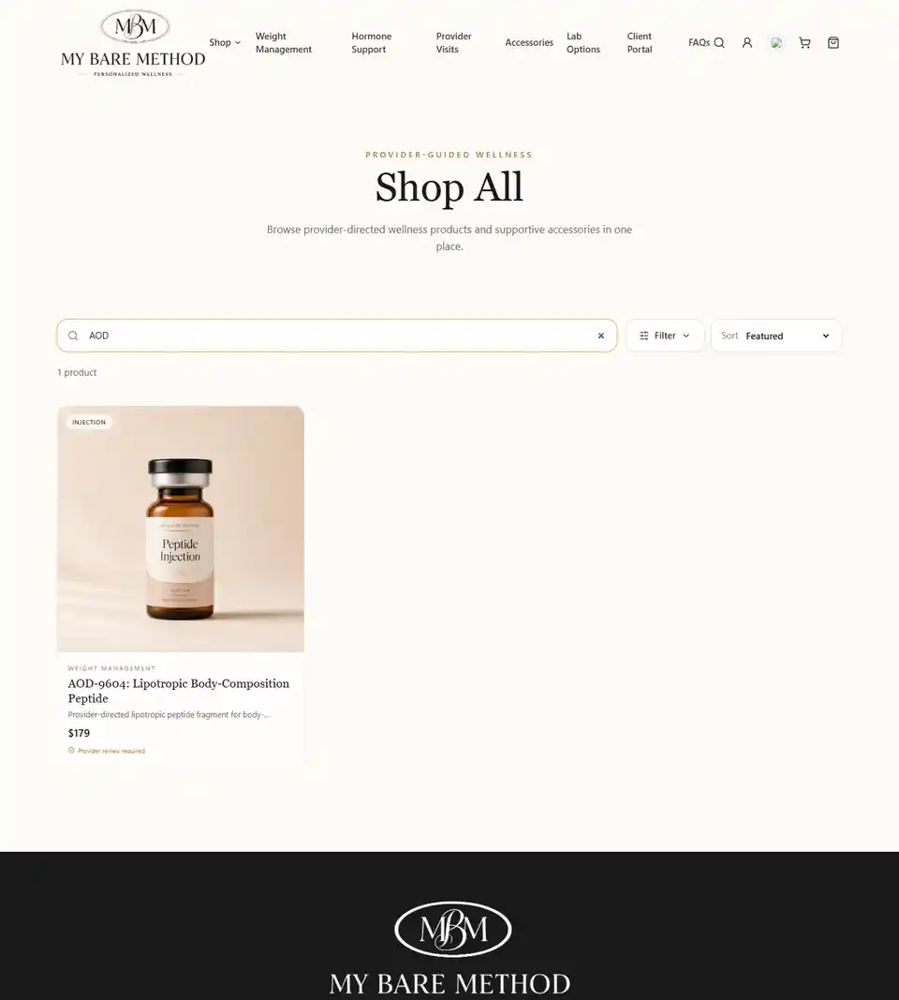
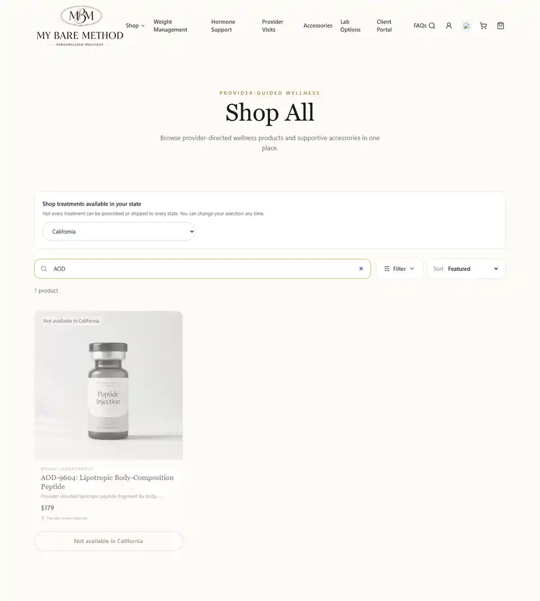
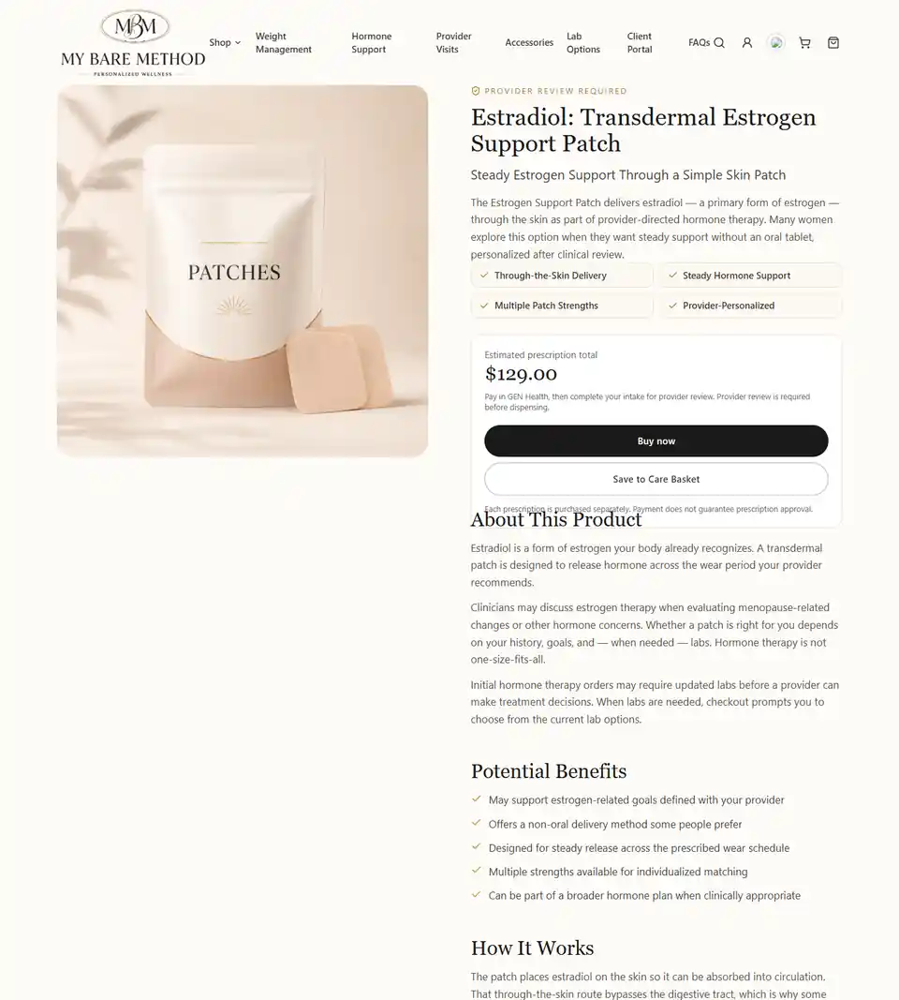
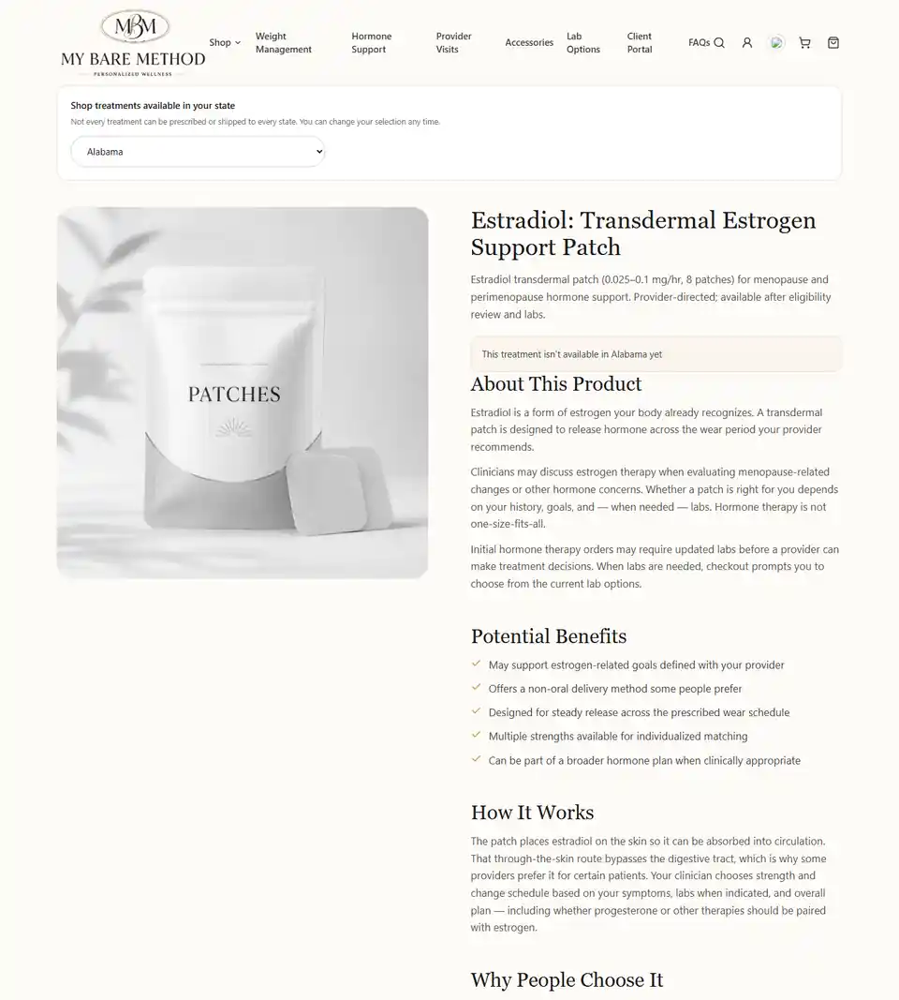
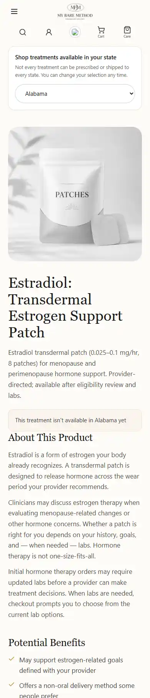

# Catalog/state availability validation — November 2026

- Base: `deploy/ach-launch-clean-2026` / `632a8b5e7e623f5101a45787c50117af7b910e96`.
- Production client build, SSR build and prerender: PASS (83 routes).
- New availability/storage unit tests: 8/8 PASS.
- Existing GEN hosted checkout tests: 8/8 PASS. Existing Care Basket selection test: PASS.
- Browser: desktop 1440×1000 and mobile 390×844. State selector, badges, disabled ordering, reload persistence, DC availability, NAD nasal/injection distinction, saved basket recheck and unchanged FAQ accordion/layout: PASS.
- Commerce snapshot comparison: all 37 product variant prices, 3 membership prices, lifecycle flags and 16 hosted route records unchanged; the only commerce name change is Scream Cream. Allowed-state Estradiol GEN URL matches the base exactly. No live payment was submitted.
- TypeScript: existing base errors reproduced (24 diagnostics in Header, ProviderCareSection, metaPixel, HomePage and existing test typings/shipping exports); none in changed files.
- Existing storefront-detail test: 8/9 PASS; the Wolverine `bpc-157-tb-500` restored-family route assertion fails on the unchanged base too. This PR does not activate or relaunch that product.
- PR screenshot previews show the changed areas; full-resolution captures are retained in the local review packet.
- Screenshot builds use the same local assets and block external widgets/requests. Existing remote-only header imagery is not available in this capture environment.

## Screenshots

| View | Before | After |
| --- | --- | --- |
| Desktop shop, AOD filter |  |  |
| Mobile shop, AOD filter |  |  |
| Desktop Estradiol |  |  |
| Mobile Estradiol |  |  |
